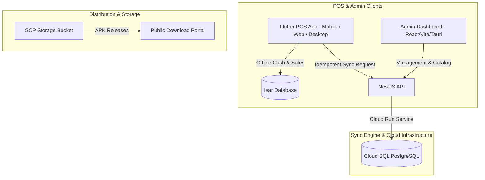

# 🚀 POS-ERP: Offline-First POS & Enterprise ERP System

Welcome to **POS-ERP (Cacharelo)**! A high-performance, offline-first Point of Sale (POS) and Enterprise Resource Planning (ERP) platform built for restaurant, café, and food service operations.

---

## 🎯 Master Goal Tracker & Feature Progress

| Feature / Module | Scope | Status | Live Production Target | Notes / Progress |
| :--- | :--- | :--- | :--- | :--- |
| **Multi-Station KDS Routing** | Backend & POS | 🟢 **Completed** | KDS Dashboard | Splits tickets dynamically between `🍳 Cocina` and `🍹 Barra`. |
| **Dynamic Admin Station Config** | Admin Dashboard & API | 🟢 **Completed** | `https://cacharelo-central.web.app` | Managers set KDS stations per category in the Admin Dashboard. |
| **Non-Intrusive Ready Orders Tray** | POS Waiter App | 🟢 **Completed** | Web POS & Android | Bell icon (`🛎️`) with ready counter badge and modal to deliver items. |
| **Sellable Menu Filtering** | POS App | 🟢 **Completed** | Web POS & Android | Limits menu strictly to `isSellable = true` products. |
| **Split Checkout & Partial Payments** | POS Cashier App | 🟢 **Completed** | Web POS & Android | Supports Equal Split and By-Item Split across Cash/Card/Transfer. |
| **Public Download Portal** | Web Portal & GCP | 🟢 **Completed** | `https://cacharelo-pos.web.app/descargas.html` | PIN-protected (`9876`) download portal for Android APK & Web POS. |
| **App Self-Update System** | POS App & API | 🟢 **Completed** | POS App | Version service check and update prompt modal (`UpdateDialog`). |
| **Idempotent DB Migrations** | Backend API | 🟢 **Completed** | Cloud SQL Postgres | Custom DDL migration runner (`idempotent-deploy-migrations.ts`). |
| **Encargado Counter & Take-Out** | POS App | 🟡 **In Progress** | POS App | Fast counter ordering & direct checkout without table allocation. |
| **PO Product Component Reuse** | Admin Dashboard | 🔵 **Planned** | `https://cacharelo-central.web.app` | Reusable product search & line-item editor for Purchase Orders. |
| **Requisitions Approval Flow** | Backend & Admin | 🔵 **Planned** | Admin & API | Branch-to-warehouse stock request and manager approval workflows. |

---

## 🌐 Live System URLs & Deployment Summary

| Application | Technology | Environment / Production Link | Deployment Command |
| :--- | :--- | :--- | :--- |
| **POS Web Application** | Flutter 3.x Web | [https://cacharelo-pos.web.app](https://cacharelo-pos.web.app) | `make flutter-web-deploy` |
| **Public Download Portal** | HTML5 / PIN 9876 | [https://cacharelo-pos.web.app/descargas.html](https://cacharelo-pos.web.app/descargas.html) | `make flutter-portal-deploy` |
| **Admin Dashboard** | React / Vite / Tauri | [https://cacharelo-central.web.app](https://cacharelo-central.web.app) | `make admin-deploy` |
| **Backend API** | NestJS / TypeScript | [https://pos-sync-api-232144991863.us-central1.run.app/api](https://pos-sync-api-232144991863.us-central1.run.app/api) | `make backend-deploy-fast` |
| **Database** | PostgreSQL 15 | GCP Cloud SQL (`pos-db-instance`) | `make backend-migrate` |

---

## 🛠 Tech Stack & Architecture



- **Frontend POS**: [`apps/pos_flutter`](file:///Users/joelmorales/web/POS-ERP/apps/pos_flutter) — Flutter 3.x targeting Android, Web, Windows, and macOS.
- **Admin Dashboard**: [`apps/business_control_tauri`](file:///Users/joelmorales/web/POS-ERP/apps/business_control_tauri) — React 18 / Vite / TailwindCSS admin interface.
- **Backend API**: [`apps/sync_api`](file:///Users/joelmorales/web/POS-ERP/apps/sync_api) — NestJS TypeScript API running on GCP Cloud Run.
- **Database**: Cloud SQL PostgreSQL managed with Drizzle ORM and idempotent DDL migration scripts.

---

## 🛠️ Quick Reference Commands (Makefile)

```bash
# 🚀 Deployment Commands
make backend-deploy-fast    # Deploy NestJS API to Cloud Run
make backend-migrate        # Run Cloud SQL database migrations
make admin-deploy           # Deploy Admin Dashboard to Firebase Hosting
make flutter-portal-deploy  # Build APK + Web POS + GCP Bucket + Firebase Hosting

# 💻 Development Commands
make dev-backend            # Run NestJS API in watch mode
make dev-frontend           # Run Flutter POS app locally
make test                   # Run unit & integration tests
```

---

## 📋 Documentation Map

- [AGENTS.md](file:///Users/joelmorales/web/POS-ERP/AGENTS.md) — Multi-session coordination protocol & agent instructions.
- [HANDOFF.md](file:///Users/joelmorales/web/POS-ERP/HANDOFF.md) — Latest session handoff report.
- [TRACKER.md](file:///Users/joelmorales/web/POS-ERP/TRACKER.md) — Detailed task-level status tracker.
- [PLAN.md](file:///Users/joelmorales/web/POS-ERP/PLAN.md) — Architectural phases & milestone checklist.
- [.claude/deployment-agent.md](file:///Users/joelmorales/web/POS-ERP/.claude/deployment-agent.md) — Complete deployment operational manual.
