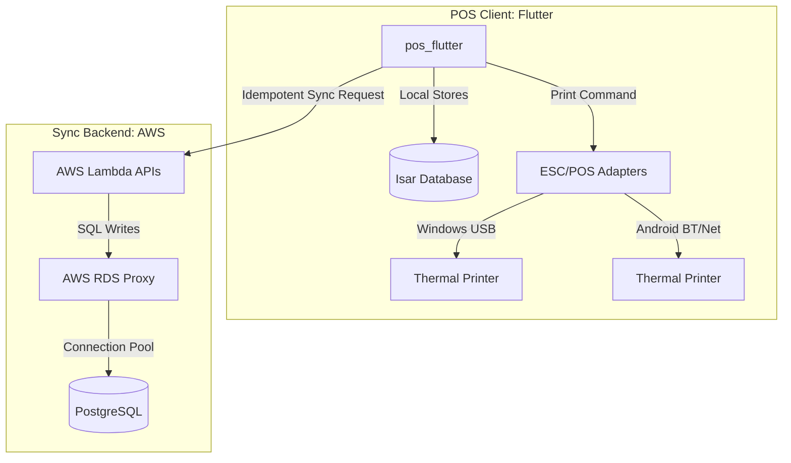

# POS-ERP: Offline-First POS & ERP System

Welcome to the **POS-ERP** repository! This is an offline-first Point of Sale (POS) and Enterprise Resource Planning (ERP) system designed for food business operations. It utilizes a shared Flutter codebase for desktop and mobile clients, synchronizing with a serverless AWS Lambda and PostgreSQL backend.

---

## 📊 Project Status & Active Files

| Document / Area | Path | Status | Description |
| :--- | :--- | :--- | :--- |
| **Living Roadmap** | [PLAN.md](file:///Users/joelmorales/web/POS-ERP/PLAN.md) | 🟢 Active | High-level phases, milestones, and progress checkboxes. |
| **Task Tracker** | [TRACKER.md](file:///Users/joelmorales/web/POS-ERP/TRACKER.md) | 🟢 Active | Detailed task assignment, statuses, and LLM session notes. |
| **LLM Tracking Spec** | [llm-tracking-spec.md](file:///Users/joelmorales/web/POS-ERP/docs/llm-tracking-spec.md) | 🟢 Complete | Portable specification of the LLM tracking system for other repos. |
| **Architecture Spec** | [spec.md](file:///Users/joelmorales/web/POS-ERP/specs/001-offline-pos-architecture/spec.md) | 🟡 In Review | Core specs, user stories, and acceptance criteria. |
| **Implementation Plan** | [plan.md](file:///Users/joelmorales/web/POS-ERP/specs/001-offline-pos-architecture/plan.md) | 🟢 Active | Phase summaries, project structure, and technology context. |
| **Offline Runbook** | [offline-sync-runbook.md](file:///Users/joelmorales/web/POS-ERP/docs/offline-sync-runbook.md) | 🟢 Complete | Recovery procedures for sync and printer failures. |

---

## 🛠 Tech Stack & Architecture



- **Frontend & Local Logic**: [pos_flutter](file:///Users/joelmorales/web/POS-ERP/apps/pos_flutter) — Shared Flutter 3.x codebase targeting Windows 10 and Android.
- **Local Database**: [Isar Database](https://isar.dev) — Locally authoritative, thread-safe transactional store using UUID v4 keys.
- **Printing**: Raw ESC/POS generation with platform adapters (USB on Windows; Bluetooth/Network on Android).
- **Backend API**: [sync_api](file:///Users/joelmorales/web/POS-ERP/apps/sync_api) — TypeScript Node.js 22.x running on AWS Lambda.
- **Cloud Database**: AWS RDS PostgreSQL connected securely through **AWS RDS Proxy** to manage connection spikes.
- **Database Migrations & Seeds**: Powered by [Knex.js](file:///Users/joelmorales/web/POS-ERP/apps/sync_api/knexfile.ts) with local database schemas defined in [apps/sync_api/migrations/](file:///Users/joelmorales/web/POS-ERP/apps/sync_api/migrations) and seeded via [apps/sync_api/seeds/](file:///Users/joelmorales/web/POS-ERP/apps/sync_api/seeds).

---

## 🛠️ Dev Commands Quick Reference (Makefile)

We use a root-level [Makefile](file:///Users/joelmorales/web/POS-ERP/Makefile) to simplify local development, testing, and deployment.

### Setup & Dev
* `make install` - Install Node.js backend and Flutter frontend dependencies.
* `make dev-backend` - Start Express API with watch/hot-reload mode.
* `make dev-frontend` - Start the Flutter client application.

### Local Database
* `make db-up` - Boot local Postgres Docker container.
* `make db-down` - Stop Postgres Docker container.
* `make db-status` - View status of Postgres Docker container.
* `make db-migrate` - Run pending migrations.
* `make db-seed` - Run seed files.
* `make db-rollback` - Rollback last batch of migrations.
* `make db-reset` - Recreate, migrate, and seed the local database.

### Quality & Deploy
* `make lint` - Run `flutter analyze` on the client application.
* `make test` - Run client unit/widget tests.
* `make infra-init` / `infra-plan` / `infra-apply` - Manage GCP infrastructure via Terraform.

---

## 🤖 LLM Workflow Tracking Mechanism

We track LLM prompts, brainstorming logs, and ongoing development tasks in Markdown files directly in the repository. This enables context preservation across chat sessions and is fully Git-friendly.

### 📁 Directory Structure

```text
├── README.md             # This Master Dashboard
├── PLAN.md               # Living roadmap with checkboxes
├── TRACKER.md            # Active task tracking table
├── prompts/              # Reusable, complex prompts
│   ├── README.md         # Guide on reusing prompts
│   └── developer_persona.md
└── logs/                 # Dated chat session transcripts
    ├── README.md         # Guide on logging sessions
    └── YYYY-MM-DD-chat.md
```

### 🚦 Tagging Guidelines

Use these tags consistently in your tracker files and commit logs so LLMs can quickly parse status:
* `#todo` - A task that is planned but not started.
* `#in-progress` - Currently being worked on by an agent or developer.
* `#blocked` - A task that cannot proceed due to external dependencies or clarifications.
* `#waiting-for-llm` - Waiting for AI output, code generation, or review.
* `#completed` - Completed and verified.

### 📝 How to Log a Session
Whenever you finish a heavy coding or design session:
1. Create a dated markdown file in `logs/` (e.g., `logs/2026-05-30-pos-sync-review.md`).
2. Briefly summarize:
   - What was accomplished.
   - Any new decisions or design changes.
   - Remaining tasks or next steps.
3. Update [PLAN.md](file:///Users/joelmorales/web/POS-ERP/PLAN.md) and [TRACKER.md](file:///Users/joelmorales/web/POS-ERP/TRACKER.md) with updated task states.
