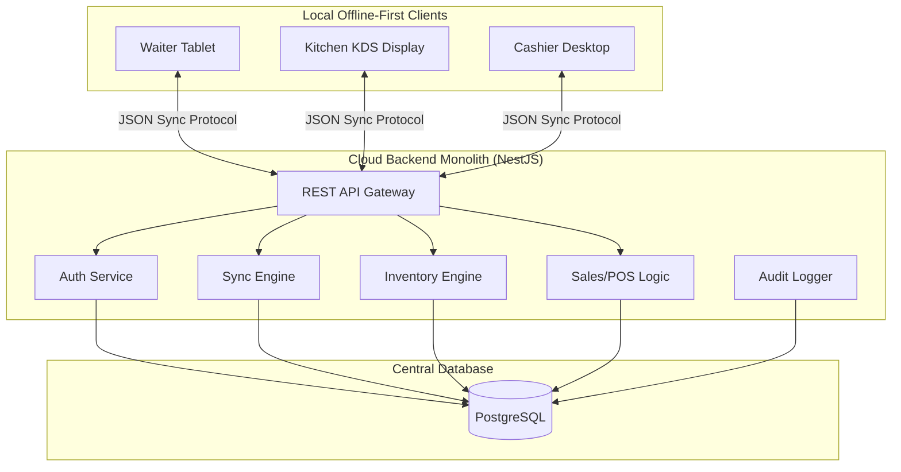
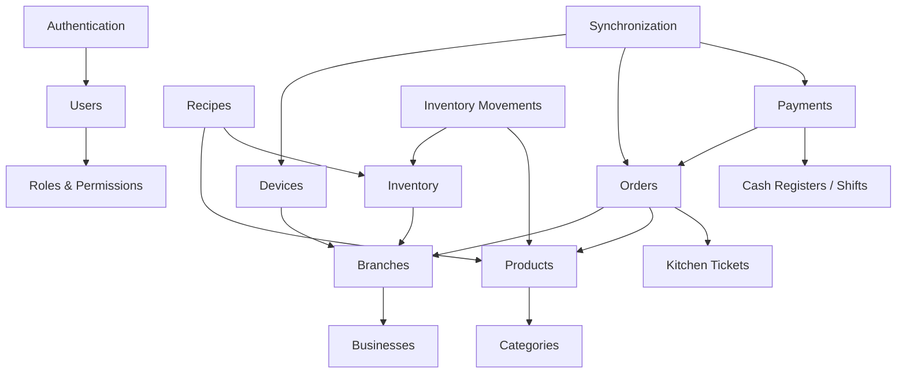

# 01: System Architecture & Modular Monolith

This document describes the high-level architecture of the POS backend. The system is designed as a **Modular Monolith** to maximize developer productivity, minimize local deployment complexity, and enforce clear domain separation.

---

## 1. System Context Diagram

The backend serves as a centralized sync gateway and management hub:

---

## 2. Modular Monolith Pattern

Every functional capability is encapsulated in a NestJS module. A module consists of its own controllers, services, entities (Drizzle schema), and tests.

### Strict Dependency Rules:
1.  **Direct Imports Forbidden**: Modules must never import providers or repositories from other modules directly (e.g., `InventoryService` cannot directly import a repository class from `ProductModule`).
2.  **Explicit Module Delegation**: If module A needs information from module B, module B must export its service (`Service`) via its module class (`@Module`), and module A must import module B.
3.  **No Circular Dependencies**: Circular dependencies (`A -> B` and `B -> A`) are compile-time errors. They must be resolved using NestJS `forwardRef()` or, ideally, by splitting the shared logic into a helper/shared module or communicating via local domain events.
4.  **Local Application Events**: Decouple modules using NestJS `EventEmitter2` for asynchronous processes (e.g., when an order is finalized, a `SalesOrderFinalizedEvent` is emitted; the `InventoryModule` listens to this event to subtract raw stock asynchronously without blocking the checkout HTTP response).

---

## 3. Module Dependency Graph

The dependency relationships between core system modules:

---

## 4. Lightweight Domain Driven Design (DDD)

We use lightweight DDD concepts to manage complexity:
*   **Bounded Contexts**: Represented by NestJS modules (e.g. `Inventory` has its own entities and business rules isolated from `Billing`).
*   **Aggregate Roots**: Core entities that manage secondary child tables (e.g., `Order` is an aggregate root that manages `OrderItem` and `OrderModifier` records. Database modifications to item lines are performed through the `Order` service).
*   **Domain Events**: Local events used to propagate side-effects across boundaries.
