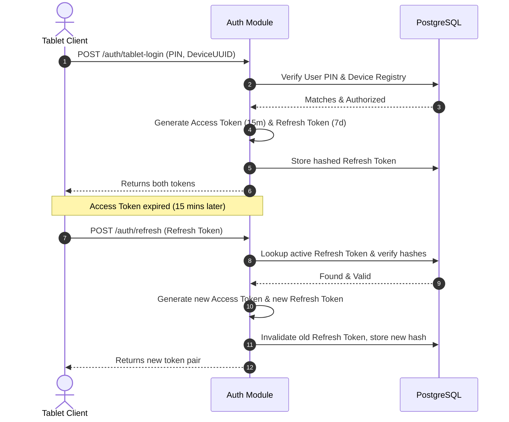

# 07: Security, Authentication Flow & Auditing

This document details the authentication design, network security settings, and logging policies.

---

## 1. Authentication & Token Rotation Flow

To support offline tablets and stateless calls, authentication is based on JWT:

---

## 2. Authorization Rules & Branch Restrictions

*   **Role-Based Access Control (RBAC)**: Enforced via a NestJS guard (`@UseGuards(RolesGuard)`). Handlers are annotated with required roles (e.g. `@Roles('cashier', 'admin')`).
*   **Tenant Boundaries**: Every controller method executing writes must evaluate the active User's `business_id` and `branch_id` from the JWT claims to block cross-tenant queries.
    *   Example: A waiter from *Branch A* is blocked from submitting a kitchen ticket for *Branch B*.

---

## 3. Network Security & Cloud Run Rules

*   **Rate Limiting**: Integrated via NestJS `@nestjs/throttler`:
    *   Maximum 100 requests per minute from a single IP.
    *   `/auth/login` and `/auth/tablet-login` are limited to 5 attempts per minute to prevent brute-force PIN guessing.
*   **CORS Configuration**: Restricts access to specific origins:
    *   Dine-in tablets/KDS use local app endpoints; CORS allows all for local apps.
    *   Web Admin panels are restricted to production cloud domains.
*   **VPC Connection (Cloud Run to Cloud SQL)**:
    *   Cloud Run connects to Cloud SQL via a private VPC connector to prevent database exposure to the public internet.
    *   All database credentials are injected dynamically at runtime via Google Secret Manager.
