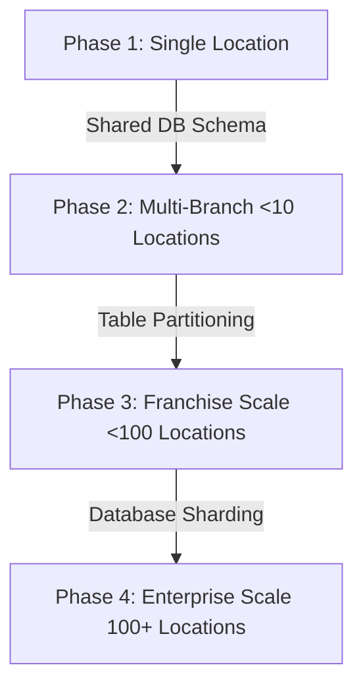

# 10: Scalability & Branch Expansion Roadmap

This document outlines how the database and server architecture scale from a single establishment to a franchise chain with 100+ branches without structural code changes.

---

## 1. Scaling Phases

### Phase 1: Single Location (Local Server / Single Cloud SQL instance)
*   **Architecture**: Single modular monolith deployment.
*   **Database**: Small Cloud SQL instance (e.g., 2 vCPU, 8GB RAM).
*   **Sizing**: < 10,000 transactions per month.

### Phase 2: Multi-Branch (Up to 10 Locations)
*   **Architecture**: Cloud Run autoscaling (max 3 instances).
*   **Tenancy**: Shared database schema. All queries carry the index filter `branch_id = :branch_id` and `business_id = :business_id`.
*   **Optimizations**: Read-only operations (such as reports) are directed to a database replica.

### Phase 3: Franchise Scale (Up to 100 Locations)
*   **Architecture**: Cloud Run replicas scaled across regions.
*   **Table Partitioning**: Implement PostgreSQL native **declarative partitioning** by list on high-volume audit tables (`inventory_movements`, `audit_logs`, `order_items`) using `business_id` or `branch_id` as the partition key.
    *   *Why*: Keeps index sizes small, optimizes query lookup speeds, and isolates tenant backups.
*   **Sizing**: > 1 million transactions per month.

---

## 2. PostgreSQL Connection Pooling & Backups

*   **Connection Pooling**:
    *   To prevent NestJS autoscaling nodes from exhausting database connection limits, we use **PgBouncer** (or Google Cloud SQL Auth Proxy) configured in transaction pooling mode.
    *   Connection limits: Max 20 connections per NestJS node container.
*   **Backup & Disaster Recovery**:
    *   **Point-in-Time Recovery (PITR)**: Configured in Google Cloud SQL with a 7-day transaction log retention window.
    *   **Daily Export**: Auto-export full schema database dumps (.sql) to a locked Google Cloud Storage bucket with a lifecycle policy of 30 days.
