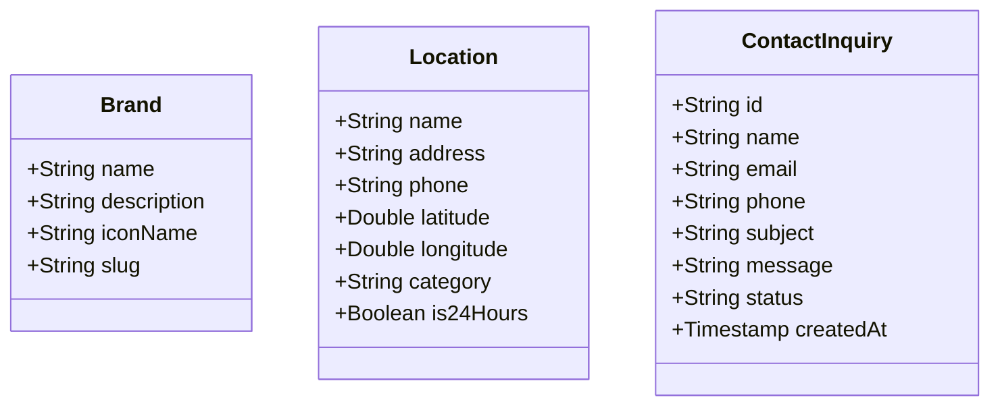

# Data Model: Grupo Cacharelo Landing Page

This document defines the structured data entities for the landing page application.

## 1. Static Client-Side Entities

These entities are defined inside the client application as hardcoded configurations or local JSON records, serving the visual sections.

### 1.1 Brand
Represents a division under Grupo Cacharelo.

| Field | Type | Description |
| :--- | :--- | :--- |
| `name` | String | Commercial name of the brand. |
| `description` | String | Slogan or description of its offering. |
| `iconName` | String | Material Symbols outlined identifier (e.g. `local_pizza`). |
| `slug` | String | URL-friendly identifier. |

**Baseline Records:**
1. Pastes y Empanadas (`De Tradición`, `local_pizza`)
2. Las Hamburguesas (`Del Imperio`, `lunch_dining`)
3. El Sabor de Antaño (`Xastipam`, `person`)
4. La Excelencia (`Multimarca`, `coffee_maker`)

### 1.2 Location
Represents physical operations plotted on the Leaflet map and displayed in lists.

| Field | Type | Description |
| :--- | :--- | :--- |
| `name` | String | Display name of the branch or checkpoint. |
| `address` | String | Physical address details. |
| `phone` | String | Contact telephone number. |
| `latitude` | Double | Latitude coordinate for map pin. |
| `longitude` | Double | Longitude coordinate for map pin. |
| `category` | String | Operational context: `city` (En La Ciudad) or `transit` (En Tránsito). |
| `is24Hours` | Boolean | True if operating 24 hours. |

---

## 2. Cloud Persistence Entities

These entities are handled by the Cloud Function and saved to Firestore.

### 2.1 ContactInquiry
Collection: `contact_inquiries`

Represents a visitor message submitted via the contact form.

| Field | Type | Constraints | Description |
| :--- | :--- | :--- | :--- |
| `id` | String | Primary Key (UUID v4) | Unique identifier generated on save. |
| `name` | String | Max 100 chars, Required | Name of the person submitting. |
| `email` | String | Valid Email format, Required | Contact email address. |
| `phone` | String | Max 20 chars, Optional | Optional contact phone. |
| `subject` | String | Max 150 chars, Required | Subject of inquiry. |
| `message` | String | Max 1000 chars, Required | Detail text of the message. |
| `status` | String | Enum: `pending`, `read`, `resolved` | Operational state of the inquiry. |
| `createdAt` | Timestamp | Server timestamp, Required | Moment of database commit. |
